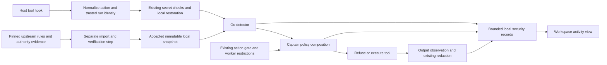

# Agent Blackbox integration plan

Status: proposed. Date: 2026-10-20. No integration is enabled by this document.

## Decision

Integrate a bounded subset of Agent Blackbox as an optional local detector.
Captain owns policy, tool refusal, redaction, task identity, and audit records.
Start in audit mode. Enable blocking only for named categories after their
source, adapter, and failure tests pass.

Use a Go evaluator for the production path. Use Blackbox's Python implementation
as the semantic reference and its TypeScript implementation as an adapter
reference. This avoids adding a JavaScript or Python runtime to every Captain
CLI worker. It also avoids maintaining two production evaluators.

The earlier suggestion to reuse the TypeScript bridge is suitable for a
disposable experiment. It is insufficient as the production design: the bridge
does not include several current Python controls. Do not import its host entry
point into Captain or install the full Hermes application for this integration.

The first useful release covers OpenCode tool calls, local findings, and an
explicit coverage report. Claude follows through the same Go evaluator.
Community publishing, external AI review, automatic installation, and a second
dashboard are outside this release.

## Review basis and limits

Upstream revision:
[`7d697683e0d56608cfe3fee374d6a6866702058a`][U0], dated 2026-10-16.
This is the same revision cited in the earlier assessment.

Captain base revision: `7f81bbcfb1b93eb76a8516a5d6c5c9ddc51aefee`.
The working tree already contained changes. Local references below describe
that working tree, including the current plugin hooks.

This is an engineering source review, not a completed security audit.
The review traced host hooks, detection, cache and trust handling, outbound
paths, audit storage, installation metadata, and selected tests.
It did not run upstream code, installers, live feeds, or upstream tests.

The source inventory contains 331 Python files under `plugins/blackbox`,
21 TypeScript files under `integrations/openclaw/src`, 173
`tests/plugins/test_blackbox*.py` files, and eight OpenClaw test scripts.
These are file counts, not test results or claims of complete review.

Plan validation: the 22 pinned source references resolve to inspected checkout
paths. Captain's formatting check, `go vet ./...`, `go build ./...`,
`captain leakcheck` for this document, and `git diff --check` passed.
Only this document was added. No dependency was added or changed.

## What Blackbox provides

| Component | Source behavior | Integration consequence |
|---|---|---|
| Hermes hooks | Pre-tool detection, post-tool audit, pre-model input inspection, and session lifecycle hooks. Pre-tool failures allow the call. | Use as the behavioral reference. Do not copy the failure policy without an explicit Captain decision. [U1] |
| Deterministic detectors | Injection text, shell shapes, dependencies, file access, skills, indicators, secret exposure, exchange-key misuse, token approvals, and keychain access. | Select a documented subset. The Python detector has more coverage than the TypeScript detector. [U2][U3] |
| Rule system | Compiled rules, local DKG lookups, cache generations, curator revocations, and community overlays. | Treat rule acquisition as a separate subsystem with its own trust tests. [U4][U5][U6] |
| OpenClaw bridge | TypeScript hooks around a detector, DKG client, audit writer, and optional reporting. | Reuse concepts and fixtures. Its host entry imports the OpenClaw SDK. [U7][U8] |
| Local audit | Findings, activity, tool events, and bounded conversation context. | Captain should store a smaller event record with reliable task and workspace identity. [U9] |
| Community | Signed statements, consent, sharing limits, disputes, and curator workflows. | Keep disconnected in the first release. This is a separate product surface. [U10] |
| Optional enrichment | OSV package lookups and an AI injection reviewer. | Disable both. Neither is required for deterministic local matching. [U11][U12] |
| Packaging | A Hermes plugin and an OpenClaw package inside a Hermes fork. | This is not a ready-made Go library or an existing Captain adapter. [U8][U13] |

The repository uses the MIT license. Preserve its copyright and permission
notice for copied or substantially derived code. The OpenClaw manifest declares
no runtime npm dependencies, but its host entry still requires the OpenClaw SDK.
This does not establish the license or dependency set of a later DKG deployment.
[U8][U14]

## Findings that change the design

These are source-backed integration limits. They are not exploit findings.

### 1. The TypeScript bridge is not at full Python parity

Python `detect_all` calls secret-exposure, exchange-key, token-approval, and
keychain detectors. TypeScript `detectAll` stops at six categories:
injection, escalation, dependency, file access, skills, and indicators.
Secret redaction helpers do not establish equivalent action detection. [U2][U3]

Python's blocking filter excludes `vulnerability`, `historical`, `flag-only`,
and indicator findings. TypeScript excludes the first two and indicators,
but does not name `flag-only` in its filter. The proposal uses explicit
eligible kinds, not a negative list that can admit a future kind. [U1][U7]

### 2. Tool names and argument fields affect coverage

TypeScript `fileAccessArg` does not recognize OpenCode's `filePath`.
Its file-tool table also does not list `grep`, `glob`, or `multiedit`.
A patch with several target files needs more than a single `path` field.
[U3]

Escalation rules match both the tool name and the command shape.
A rule for `terminal` does not automatically match `bash`.
Define tested semantic aliases. Keep the original tool name and rule identifier
in the record. Do not apply broad name substitution to arbitrary MCP tools.

### 3. Empty rules do not mean complete inactivity or complete protection

Graph-backed matches need rules. Built-in discovery and configured protected
paths can still produce findings when the graph is empty.
Therefore, neither “nothing works” nor “protected” is an adequate empty-cache
status. Report coverage by category and rule generation. [U3][U7]

### 4. The two rule paths have different trust and freshness behavior

The TypeScript refresh reads only `verifiable-memory`. Its disk loader removes
community rows. The Python path also applies community and curator overlays.
Do not infer bridge coverage from the root README's three-tier description.
[U4][U6][U15]

TypeScript maps missing or unknown rule sources to `public`. Its cache loader
does not enforce a matching graph identity. An empty refresh advances
`fetchedAt` while keeping old rules. Its cache write uses a direct file write.
Captain must validate sources, bind caches to an authority, keep successful-sync
time separate from retry time, and replace generations atomically. [U3][U15]

Python has graph-bound generations, separate scheduling timestamps, atomic
cache replacement, and signed curator revocation handling.
Those controls must survive an export. A copied `ruleset.json` is not itself
proof that a rule is authentic or current. [U4][U5][U6]

### 5. “Offline hot path” needs a precise definition

TypeScript matching reads in-memory rules, while a stale cache can trigger a
background DKG refresh. Python dependency and indicator lookups can query the
node's local store during detection.
Do not adopt the README's latency claim as a Captain benchmark. [U2][U15][U16]

The proposed evaluator performs no network or graph query while a tool waits.
This means an exporter must prove the completeness of each selected snapshot
category. A compiled cache can be a fallback or subset of the live rule space.
It must not be advertised as full live-feed coverage.

### 6. Regex exception handling does not impose a time limit

Python validates patterns with `safe_regex` before compilation.
TypeScript constructs JavaScript `RegExp` objects and catches errors.
That catch does not interrupt a match that consumes excessive CPU. [U3][U17]

Use Go's standard `regexp` engine for accepted patterns. Reject unsupported
syntax and report the omitted rule count. Do not silently rewrite lookarounds
or backreferences. Require semantic fixtures for every transformed rule.
Caps still apply to rule count, input size, and total work.

### 7. Optional network paths can disclose local information

The TypeScript default enables OSV lookup. The request includes package name,
ecosystem, and version, including a package that later returns no finding.
The optional Python AI reviewer sends bounded, redacted text to a provider.
[U11][U12]

Sharing is opt-in in the inspected configuration and consent code.
Some descriptive text still says otherwise. Captain should enforce its own
explicit settings and must not inherit upstream environment overrides.
No outbound action follows from merely enabling local detection. [U10][U18]

### 8. Upstream audit rows need adaptation

The TypeScript activity log records session, run, and tool-call IDs.
Its separate finding writer does not carry those IDs or the final block
decision in the same row. Its workspace helper identifies an OpenClaw profile.
That is not Captain's per-session repository identity. [U7][U9]

Captain needs one finding record that contains correlation and disposition.
Post-tool observation must never be presented as prevention.
Redacted transcripts are still sensitive. Do not copy them into the initial
security event stream.

### 9. Dependency and shell parsing have defined limits

The inspected TypeScript parser recognizes selected npm, Python, Cargo,
RubyGems, and Homebrew commands. It supports exact package versions and
package-wide `@*` rules. Its table does not cover `go get`. [U3]

It does not establish resolved transitive dependencies or general shell
semantics. Variables, generated commands, interpreter scripts, aliases, and
wrapper tools require separate fixtures or an `unsupported` result.
This is action screening, not a replacement for lockfile analysis.

### 10. Existing tests are useful, but availability is not evidence of a pass

The repository has tests for trust tiers, regex bounds, secret handling,
revocations, cache refresh, signing, redaction, and host parity.
Some Python-to-TypeScript parity tests skip when Node or `tsx` is absent.
The OpenClaw package is not listed in the root npm workspaces. [U19][U20][U21]

The bridge's `check:sdk` script installs `openclaw@latest`.
Use exact host and toolchain versions for Captain's tests.
Require the selected parity cases to execute; a skip must fail the release gate.
No upstream suite pass is claimed by this review. [U8]

## Current Captain integration points

| Existing file | Current role | Proposed use |
|---|---|---|
| `plugin/captain.ts:519` | Pre-tool sent-turn policy, secret-file checks, argument restoration, action gate, then jail wrapping. | Insert the detector after restoration and before final execution wrapping. Keep existing refusals authoritative. |
| `plugin/captain.ts:558` | Post-tool output redaction. | Inspect bounded output locally, then preserve existing masking. Record this as observation. |
| `pkg/captaincode/gate.go:175` | `GateAction` and model-based action screening. | Reuse identity conventions. Define a richer security action; the current flattened command and path lose nested targets and text. |
| `cmd/captaincode/gate_cmd.go:132` | OpenCode CLI adapter and Claude hook adapter. | Follow the CLI transport pattern. Keep deterministic detection independent of the configured decision model. |
| `pkg/captaincode/initproxy.go:212` | Claude hook installation. | Register the future composed security hook without deleting unrelated user hooks. |
| `pkg/captaincode/legs.go:2394` | Claude per-run settings and task environment. | Supply trusted task identity and preserve sent-turn restrictions. |
| `pkg/captaincode/gate_sessions.go:18` | Retrospective session-to-task intervals. | Reuse for historical joins; add explicit run-start registration for live security records. |
| `pkg/captaincode/codexcli.go:350` | CLI command events. | Use for observation only until a supported pre-execution control is proven. |
| `pkg/captaincode/workerguard.go` | Publishing and staging guard. | Keep it independent. A command shim is not complete file, network, or MCP coverage. |
| `plugin/e2e/combined.ts` | Local combined runtime harness. | Add hook-presence, refusal-before-side-effect, isolation, and recovery cases. |

The new detector must not depend on `gateConfigured()`, `GATED_TOOLS`,
`GateScreens`, or `CAPTAIN_ROUTE_PLUGIN=1`.
Those conditions serve other purposes and exclude security-relevant reads.
The check must run where the worker executes the tool.

Claude hooks need special care. Do not assume separately installed hooks run
serially or see each other's `updatedInput`. Use one Captain composition path
for the controlled worker, or evaluate a locally restored copy and prove that
the final executed input matches it. Preserve other user hooks.

## Architecture



The update step accepts rules and authority evidence. The tool hook reads an
already accepted local generation. Captain combines the detector result with
existing restrictions and records the final decision.

### Evaluator

Implement a small Go package with no network imports or execution capability.
Use the standard library and existing dependencies first.
Its input is a normalized action plus an immutable snapshot.
Its output separates findings, coverage, and evaluation errors.

The proposed CLI is `captain blackbox check`, with JSON on stdin and stdout.
It does not exist today. Use a fixed argument vector and bounded pipes.
Never pass command text through shell interpolation or put secrets in argv.
The initial CLI may load a snapshot per call; benchmark before adding a cache.

If process startup or snapshot parsing misses the budget, use an existing
Captain-owned process for the same evaluator with authenticated local IPC.
That is a later measured choice. Do not introduce a new network listener in
the first release.

### Normalized action

Carry these fields independently:

- Schema version, action ID, host, phase, original tool name, and semantic tool kind.
- Trusted workspace ID, worker session ID, task ID, run ID, and tool-call ID.
- Actual command, all file targets, destination URLs, package candidates, and bounded text.
- Content origin: user request, tool argument, fetched content, tool result, or trusted runtime instruction.
- Parse status, omitted fields, and truncation status.

Raw action fields remain in local process memory. Persistent records use only
approved summaries. Resolve relative paths against the actual session
workspace. Account for symlinks, missing write targets, patch renames, and
case behavior. Path matching does not remove filesystem race conditions.

Preserve original names while mapping supported aliases. Add explicit handling
for OpenCode `filePath`, Claude `file_path`, notebooks, multi-edit arrays, and
patch targets. Unknown MCP tools get a named coverage gap.
Do not flatten all fields into one string and then claim full coverage.

### Rule import and authority

The first audit fixtures can use synthetic rules. Real rule import is a
separate step. Build a narrow exporter around the pinned upstream rule and
authority code; do not port the entire DKG trust system into the first PR.
There is no assumed stable, ready-made snapshot API.

An accepted generation must identify:

- Schema and engine compatibility versions.
- Upstream revision, graph, network, authority, and trust-root identity.
- Rule identifiers, source tiers, eligible kinds, and category counts.
- Export scope and whether each category is complete.
- Manifest sequence, revocations, expiry, and the last successful verification time.
- Content digest and the evidence used to authenticate it.
- Unsupported patterns and any other omitted records.

A digest detects a changed file. It does not authenticate its publisher.
Audit imports without sufficient authority evidence remain `unverified`.
They cannot become blockable merely because a row says `source: public`.
Unknown source tags and schemas are rejected.

Preserve the last accepted generation when an update fails. Do not reset its
successful-sync timestamp. Validate the full candidate before atomic
replacement. Keep accepted revocations across restart and reject replayed
authority generations.

Use owner-private storage with bounded, no-follow file reads. Worker
containment must prevent changes to policy and rule files when enforcement is
claimed. File permissions alone cannot constrain a worker with the same user
identity and unrestricted host access.

### Policy and failure behavior

Proposed mode setting: `CAPTAIN_BLACKBOX=off|audit|enforce`.
Default: `off`; the initial pilot explicitly selects `audit`.
These are proposed settings, not existing options.
Use `critical` as the initial block threshold.

| Condition | Audit | Enforce for a required, supported category |
|---|---|---|
| Eligible trusted match at the configured threshold | Record `would_block`; continue through existing controls. | Refuse this action. |
| Successful complete evaluation, no eligible match | Record evaluated coverage. | Continue through existing controls. |
| Community, heuristic, vulnerability, historical, indicator, or unknown-kind finding | Record only. | Record only; it cannot authorize a block. |
| Detector error, timeout, malformed response, missing required rules, expired authority, or incomplete required input | Mark degraded; existing controls decide. | Refuse with `security_check_unavailable`, not a claim of malicious intent. |
| Category outside the configured enforcement scope | Mark unsupported or audit-only. | Do not claim protection for that category. |
| Existing Captain refusal | Refuse. | Refuse. |

Start with selected exact known-malware package rules and explicit local path
rules. Keep prompt-injection classification advisory during the first release.
Its meaning depends on source context and legitimate user intent.
Retain Captain's present secret handling regardless of Blackbox mode.
Preserve masked `.env` reads by default. Do not copy upstream protected-path
defaults into a new refusal policy without an explicit operator choice.

Each decision pins one snapshot generation and one immutable action.
A later rule refresh cannot change the meaning of that recorded decision.
Existing denial always wins. A detector result cannot grant permission.

Do not permit a worker to reroute or retry the same refused action through an
uncovered transport. Surface the refusal to the task. Keep an operator
override narrow, time-limited, and local, with a reason and a testable audit
record.

### Records and UI

Proposed storage: a dedicated `security.jsonl` stream under Captain's state
directory. Do not append untyped records to routing logs or alter quality scores.
Use one bounded writer or isolated per-process files with a safe merge.
Test concurrent appends, rotation, disk-full behavior, and partial final lines.

Each record contains schema version, event ID, time, workspace/task/session/run
IDs, tool-call ID, phase, category, rule ID, source, kind, severity, disposition,
mode, coverage, snapshot digest, duration, and a safe reason code.
Do not store command bodies, prompts, secret values, or full transcripts by
default. Sanitization applies to rule titles and identifiers too.

The workspace activity view should distinguish `blocked`, `would_block`,
`observed_after_execution`, `degraded`, and `not_covered`.
Show active rule age and supported transports.
Use exact IDs for joins. Never guess a task from its process name or timestamp.

Expose findings through the existing workspace-scoped read path when that
interface is ready. Any new read endpoint must validate scope and bound results.
The UI must not render external rule text as HTML or treat it as instructions.
Reuse the current UI instead of starting the upstream dashboard.

## Alternatives considered

| Approach | Benefit | Cost or limit | Decision |
|---|---|---|---|
| Install the full Blackbox/Hermes stack | Broad upstream features. | New runtime, node lifecycle, dashboard, configuration changes, and host coupling. | Exclude from initial integration. |
| Import the OpenClaw host entry | Existing hooks and local logs. | Requires its SDK and carries sync, reporting, and host identity assumptions. | Reject for Captain. |
| Embed selected TypeScript detector files | Fast OpenCode-only experiment. | Does not solve CLI coverage or current Python parity gaps. | Optional disposable comparison harness. |
| Run canonical Python per action | Reuses more upstream behavior. | Runtime and import cost; live lookup and host coupling need separation. | Reference testing, not the initial production path. |
| Port a bounded evaluator to Go | One engine for all Captain adapters; existing runtime. | Requires explicit parity fixtures and upkeep. | Recommended, with a narrow coverage contract. |

## Delivery plan

Each phase is one reviewable PR or a small sequence within this repository.
Do not combine the work with unrelated runtime changes.

| Phase | Work and likely files | Exit condition |
|---|---|---|
| 0. Contracts and fixtures | `pkg/captaincode/blackbox_types.go`, `pkg/captaincode/testdata/blackbox/`, host mapping fixtures, upstream revision and license record. | Every selected category has positive, negative, unsupported, and failure cases. Define the snapshot/export contract and selected host versions. |
| 1. Offline evaluator | `pkg/captaincode/blackbox_*.go`, `cmd/captaincode/blackbox_cmd.go`, command registration in `main.go`. | Synthetic snapshots work without network or a configured model. All malformed, unknown-source, and oversized cases return explicit status. |
| 2. OpenCode audit pilot | `plugin/captain.ts`, adapter tests, `plugin/e2e/combined.ts`, local event writer, configuration docs. | Actual worker tools reach the hook. Existing redaction, gates, jail wrapping, cancellation, and concurrent sessions retain their behavior. |
| 3. Rule import | Narrow exporter/importer, snapshot verification tests, private cache storage, status output. | Full selected-category export is demonstrated. Wrong graph, replay, invalid authority, omissions, and failed refresh cannot produce healthy blocking status. |
| 4. Claude and coverage UI | `pkg/captaincode/initproxy.go`, controlled worker hook composition, `pkg/captaincode/legs.go`, session registration, activity view. | Final restored arguments are screened. User hooks survive. Findings join the correct task. Other transports remain explicitly uncovered. |
| 5. Selective enforcement | Policy table, scoped overrides, refusal classification, rollback tests. | Release gates below pass for each enabled category and host. Operator selects the enforcement scope. |

Do not begin phase 5 if phase 3 cannot establish snapshot completeness and
authority. An audit-only result remains useful and must be labelled accurately.

Possible upstream contributions are the `filePath` mapping, explicit
`flag-only` handling, bounded regex behavior, cache identity/freshness fixes,
and a stable snapshot export contract. Prepare small regression cases first.
Opening issues or pull requests is separate from this plan.

## Required validation

| Area | Required evidence |
|---|---|
| Host adapters | Real OpenCode hook invocation; Claude input-update behavior; read/write/edit/patch/multi-edit/fetch/MCP mapping; unknown tools shown as gaps. |
| Actual prevention | A blocked synthetic write or command leaves no side effect. Post-tool alerts are never counted as blocked calls. |
| Policy composition | Existing denials still deny; model gate absent does not disable Blackbox; jail wrapping uses the screened command; no failover around a refusal. |
| Identity | Two simultaneous workspaces, reused sessions, detached runs, missing IDs, and stale registrations never cross-attribute a finding. |
| Trust | Unknown source, forged `public`, wrong graph/network/root, stale manifest, revoked rule, replayed generation, partial export, and invalid digest. |
| Failure | Empty cache, corrupt cache, detector timeout/crash, unavailable CLI, malformed response, disk full, interrupted update, and restart. |
| Parsers | `filePath`, `file_path`, symlinks, relative paths, spaces, nested patches, shell substitutions, package version ranges, unpinned packages, and unsupported `go get`. |
| Privacy | Synthetic secrets in arguments, output, URLs, titles, rule IDs, and errors never reach logs or network. Verify zero outbound connections from the evaluator. |
| Injection | Distinguish a user instruction, a quoted security example, a fetched instruction, a tool result, and trusted runtime text. Include long and Unicode inputs. |
| Regex and limits | Unsupported syntax, excessive patterns, nested input, truncation boundaries, and adversarial text complete within the budget or return unavailable. |
| Rule parity | Run selected Python, TypeScript, and Go fixtures where applicable. Record expected deviations. Required tests cannot skip. |
| Operations | Atomic cache update, concurrent log writes, rotation, override expiry, rollback, and observable degraded status. |

Provisional performance targets: p95 evaluator time at most 25 ms and p99
total hook overhead at most 100 ms on a declared fixture and ruleset size.
Use a 250 ms outer evaluation deadline for the initial experiment.
Measure cold start separately. These are targets, not observed results.

Set explicit payload, record, depth, and rule-count limits before phase 1.
Any limit that omits security-relevant input produces `incomplete`, not `clean`.
Input limits must account for full patch target lists and supported large tools.

Before enforcement, review at least 1,000 benign pilot actions across the two
supported hosts and at least two disposable workspaces. Require zero unexplained
would-block results in the enabled categories. Treat this as a rollout gate,
not a statistical proof of universal detection or absence of false positives.

Run foreign reference tests only in a network-disabled OS sandbox with an
allowlisted environment, read-only source/toolchain, scratch-only writes, and
CPU, memory, process, file-size, disk, and wall-clock limits.
Use dummy secrets and local fixtures. Do not contact live feeds in these tests.

Captain's current CI checks are:

```sh
gofmt -l cmd pkg examples/openshell-pilot/shield
GOTOOLCHAIN=local GOPROXY=off go vet ./...
GOTOOLCHAIN=local GOPROXY=off go test ./...
GOTOOLCHAIN=local GOPROXY=off go build ./...
```

Run focused Go tests first. Run the combined runtime harness with its existing
isolated fixture setup after adapter changes. Define an explicit TypeScript
check for the changed plugin; the current UI package has no typecheck script.
Do not use an upstream script that installs a floating host version.

## Rollout and rollback

1. Ship disabled, with local synthetic evaluation available.
2. Enable audit for selected OpenCode workspaces.
3. Import verified real rules and measure coverage, costs, and false positives.
4. Add Claude only after its final-input hook behavior is proven.
5. Enable enforcement for named hosts and categories.

Rollback changes the Blackbox mode to audit or off. It does not disable
Captain's redaction, sent-turn policy, worker guard, or sandbox controls.
Retain the previous accepted snapshot and the decision history.
Prove when configuration changes take effect in each host.

No live brain restart, host switch, package installation, or external
publication is authorized by this document.

## Open decisions before implementation

- Can upstream provide a stable export with complete selected rule categories
  and verifiable authority evidence, including revocations?
- Which exact host versions expose the required pre-tool and post-tool hooks?
- Which regex and identifier semantics must the first Go subset reproduce?
- What rule-count and input-size budgets meet the measured hook budget?
- Which worker containment profile prevents changes to enforcement state?

These questions do not prevent phases 0–2 with synthetic rules and audit mode.
They do prevent a claim of production blocking coverage.

## Source references

All upstream links below point to the reviewed revision.

[U0]: https://github.com/umanitek/agent-blackbox/tree/7d697683e0d56608cfe3fee374d6a6866702058a
[U1]: https://github.com/umanitek/agent-blackbox/blob/7d697683e0d56608cfe3fee374d6a6866702058a/plugins/blackbox/guard/hooks.py
[U2]: https://github.com/umanitek/agent-blackbox/blob/7d697683e0d56608cfe3fee374d6a6866702058a/plugins/blackbox/detection/detectors.py
[U3]: https://github.com/umanitek/agent-blackbox/blob/7d697683e0d56608cfe3fee374d6a6866702058a/integrations/openclaw/src/detection.ts
[U4]: https://github.com/umanitek/agent-blackbox/blob/7d697683e0d56608cfe3fee374d6a6866702058a/plugins/blackbox/ruleset/refresh_cycle.py
[U5]: https://github.com/umanitek/agent-blackbox/blob/7d697683e0d56608cfe3fee374d6a6866702058a/plugins/blackbox/ruleset/disk_cache.py
[U6]: https://github.com/umanitek/agent-blackbox/blob/7d697683e0d56608cfe3fee374d6a6866702058a/plugins/blackbox/ruleset/curator_tier.py
[U7]: https://github.com/umanitek/agent-blackbox/blob/7d697683e0d56608cfe3fee374d6a6866702058a/integrations/openclaw/src/index.ts
[U8]: https://github.com/umanitek/agent-blackbox/blob/7d697683e0d56608cfe3fee374d6a6866702058a/integrations/openclaw/package.json
[U9]: https://github.com/umanitek/agent-blackbox/blob/7d697683e0d56608cfe3fee374d6a6866702058a/integrations/openclaw/src/audit.ts
[U10]: https://github.com/umanitek/agent-blackbox/blob/7d697683e0d56608cfe3fee374d6a6866702058a/plugins/blackbox/community/sharing.py
[U11]: https://github.com/umanitek/agent-blackbox/blob/7d697683e0d56608cfe3fee374d6a6866702058a/integrations/openclaw/src/osv.ts
[U12]: https://github.com/umanitek/agent-blackbox/blob/7d697683e0d56608cfe3fee374d6a6866702058a/plugins/blackbox/detection/reviewer.py
[U13]: https://github.com/umanitek/agent-blackbox/blob/7d697683e0d56608cfe3fee374d6a6866702058a/plugins/blackbox/plugin.yaml
[U14]: https://github.com/umanitek/agent-blackbox/blob/7d697683e0d56608cfe3fee374d6a6866702058a/LICENSE
[U15]: https://github.com/umanitek/agent-blackbox/blob/7d697683e0d56608cfe3fee374d6a6866702058a/integrations/openclaw/src/ruleset.ts
[U16]: https://github.com/umanitek/agent-blackbox/blob/7d697683e0d56608cfe3fee374d6a6866702058a/plugins/blackbox/ruleset/live/lookup.py
[U17]: https://github.com/umanitek/agent-blackbox/blob/7d697683e0d56608cfe3fee374d6a6866702058a/plugins/blackbox/ruleset/safe_regex.py
[U18]: https://github.com/umanitek/agent-blackbox/blob/7d697683e0d56608cfe3fee374d6a6866702058a/integrations/openclaw/src/config.ts
[U19]: https://github.com/umanitek/agent-blackbox/tree/7d697683e0d56608cfe3fee374d6a6866702058a/tests/plugins
[U20]: https://github.com/umanitek/agent-blackbox/blob/7d697683e0d56608cfe3fee374d6a6866702058a/tests/plugins/test_blackbox_sharing_gate_parity.py
[U21]: https://github.com/umanitek/agent-blackbox/blob/7d697683e0d56608cfe3fee374d6a6866702058a/package.json
